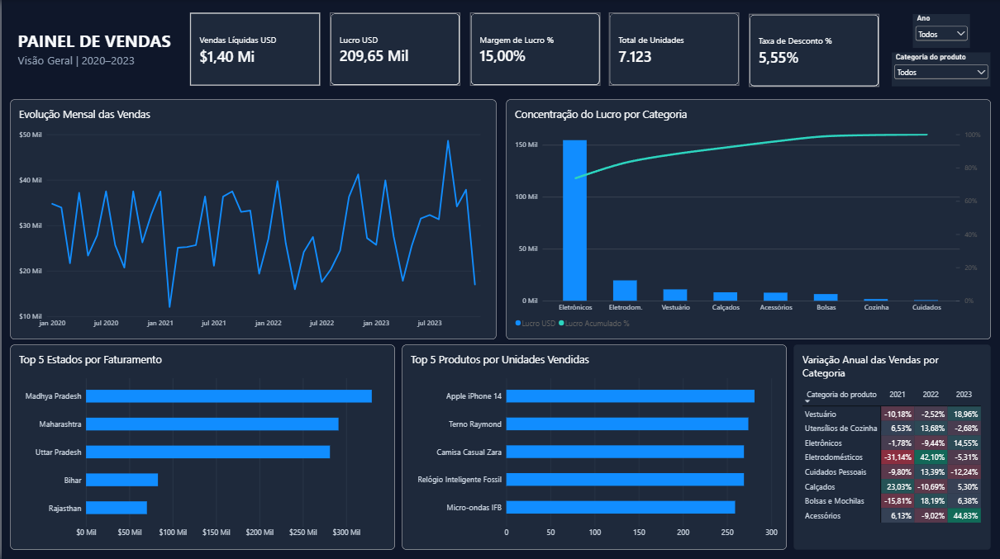

## Dashboard de Vendas | Projeto Acadêmico de Business Intelligence

Projeto de análise de vendas desenvolvido utilizando Python, Pandas, Power BI e DAX, com foco no tratamento de dados, modelagem dimensional e construção de indicadores para análise de desempenho comercial.

### Sobre o Projeto

Este dashboard foi desenvolvido inicialmente como parte de um trabalho de Projeto Integrador (PI) do curso de Análise e Desenvolvimento de Sistemas, do Centro Universitário Senac.

O trabalho utiliza uma base fictícia de vendas, com informações referentes ao período de 2020 a 2023.

A proposta foi aplicar conhecimentos adquiridos durante a graduação, passando por diferentes etapas de um projeto de análise de dados: preparação da base, organização das informações, criação de medidas e desenvolvimento de visualizações.

Após a etapa acadêmica, continuei aprimorando o projeto, realizando ajustes na estrutura dos dados, nos indicadores e na apresentação visual do dashboard.

### Minha Trajetória na Área de Dados

Atualmente, curso Análise e Desenvolvimento de Sistemas e atuo como estagiário na área de Dados.

Estou em um processo de aprendizado e desenvolvimento profissional, buscando ampliar meus conhecimentos em SQL, Python, Power BI e outras ferramentas relacionadas à análise de dados.

O desenvolvimento deste dashboard faz parte dessa trajetória. Além de atender à proposta acadêmica, foi uma oportunidade de trabalhar com ferramentas que estou conhecendo e aprofundando meus conhecimentos.

Ao longo do projeto, pude praticar o tratamento de dados com Python e Pandas, a organização de um modelo dimensional e a construção de medidas e visualizações no Power BI.

Este repositório faz parte do meu portfólio de estudos e projetos, no qual pretendo registrar minha evolução técnica e as experiências adquiridas durante minha formação.

**Natureza do projeto:** acadêmico, desenvolvido com dados fictícios para fins educacionais e demonstrativos.

### Base de Dados

O projeto utiliza uma base fictícia de vendas, com registros referentes ao período de 2020 a 2023.

Após a preparação dos dados, foram utilizados 3.509 registros de vendas, organizados em um modelo dimensional.

A base contempla:

- 30 produtos, distribuídos em 8 categorias.
- 50 clientes.
- Informações de vendas, descontos e lucro.
- Dados geográficos dos clientes.
- Histórico de datas e promoções.

Os valores financeiros estão representados em dólares americanos (USD).

### Tratamento e Preparação dos Dados

A preparação dos dados foi realizada utilizando Python e a biblioteca Pandas.

Inicialmente, explorei a estrutura da base para compreender as informações disponíveis e identificar os ajustes necessários antes da utilização no Power BI.

Entre as atividades realizadas, destacam-se:

- Leitura e inspeção dos arquivos CSV.
- Verificação dos tipos de dados e padronização de campos.
- Tratamento dos formatos numéricos e de datas.
- Delimitação do período analisado.
- Separação das informações em tabelas de fatos e dimensões.
- Padronização dos nomes dos produtos e categorias para português.
- Exportação das tabelas tratadas para utilização no Power BI.

Essa etapa foi importante para compreender a preparação de dados e sua influência na qualidade das análises.

### Modelagem Dimensional

No Power BI, os dados foram organizados utilizando uma estrutura de modelo estrela (*Star Schema*), separando os registros de vendas das informações descritivas.

A modelagem foi composta pelas seguintes tabelas:

| Tabela | Finalidade |
|---|---|
| `Fato_Vendas` | Armazena os registros e valores das vendas |
| `Dim_Produtos` | Informações dos produtos e suas categorias |
| `Dim_Clientes` | Dados cadastrais e geográficos dos clientes |
| `Dim_Promocoes` | Informações relacionadas às promoções |
| `Dim_Datas` | Calendário utilizado nas análises temporais |

Os relacionamentos foram configurados no padrão um-para-muitos (1:N), conectando as dimensões à tabela fato.

A utilização desse modelo permitiu organizar as informações para a construção de indicadores e a aplicação de filtros nas análises.

### Indicadores e Medidas DAX

Para acompanhar o desempenho das vendas, foram criadas medidas utilizando a linguagem DAX (*Data Analysis Expressions*), disponível no Power BI.

O dashboard apresenta cinco indicadores principais:

| Indicador | Resultado | Finalidade |
|---|---:|---|
| Vendas Líquidas | US$ 1.397.652,69 | Acompanhar o faturamento após descontos |
| Lucro Total | US$ 209.647,90 | Identificar o resultado financeiro das vendas |
| Margem de Lucro | 15,00% | Avaliar a lucratividade em relação às vendas líquidas |
| Unidades Vendidas | 7.123 | Acompanhar o volume de produtos vendidos |
| Taxa de Desconto | 5,55% | Medir a proporção dos descontos sobre as vendas brutas |

Os resultados representam o conjunto completo de dados do projeto, considerando o período de 2020 a 2023, sem aplicação de filtros.

#### Lógica dos Indicadores

**Vendas Líquidas:** soma dos valores líquidos registrados nas vendas.

**Lucro Total:** soma dos valores de lucro das transações.

**Margem de Lucro:** divisão do lucro total pelas vendas líquidas, expressa em percentual.

**Unidades Vendidas:** soma das quantidades comercializadas.

**Taxa de Desconto:** divisão do valor total concedido em descontos pelo valor total das vendas brutas.

As medidas foram desenvolvidas para responder dinamicamente aos filtros de ano e categoria de produto aplicados no relatório.

Além dos indicadores principais, foram utilizados cálculos para analisar o percentual acumulado de lucro por categoria e a variação percentual das vendas entre anos.

A construção dessas medidas foi uma oportunidade de praticar conceitos de agregação, contexto de filtro e análise temporal utilizando DAX.

### Visualizações e Análises

O dashboard foi desenvolvido no Power BI para reunir indicadores de desempenho comercial e permitir a exploração dos dados por meio de filtros interativos.

As análises foram organizadas em cinco visualizações:

**Evolução Mensal das Vendas**

Gráfico de linhas que apresenta o comportamento das vendas ao longo de 2020 a 2023, permitindo observar variações no faturamento entre os meses.

**Concentração do Lucro por Categoria**

Gráfico combinado baseado na análise de Pareto, apresentando o lucro de cada categoria e seu percentual acumulado. O objetivo é identificar quais grupos de produtos possuem maior participação no resultado financeiro.

**Top 5 Estados por Faturamento**

Comparação dos cinco estados com maior volume de vendas líquidas, utilizando barras horizontais.

**Top 5 Produtos por Unidades Vendidas**

Ranking dos produtos com maior quantidade de unidades comercializadas.

**Variação Anual das Vendas por Categoria**

Matriz que apresenta a variação percentual das vendas entre anos, com formatação condicional para destacar resultados positivos e negativos.

O relatório conta ainda com filtros por ano e categoria de produto, permitindo analisar diferentes recortes da base.

### Principais Observações

A partir da análise dos dados, foi possível identificar alguns resultados:

- A categoria Eletrônicos concentra aproximadamente três quartos do lucro total da base analisada.
- Madhya Pradesh apresenta o maior faturamento entre os estados do ranking.
- Apple iPhone 14 lidera o ranking de produtos por unidades vendidas.
- As categorias apresentam comportamentos diferentes ao longo dos anos, com períodos de crescimento e redução nas vendas.

Essas observações foram obtidas a partir de uma base fictícia e têm finalidade demonstrativa. O foco do trabalho foi praticar a interpretação de indicadores e a apresentação de informações de forma acessível.

### Visualização do Dashboard

A imagem abaixo apresenta o dashboard desenvolvido no Power BI, com indicadores de vendas, lucratividade, desempenho por categoria e análises temporais.




### Como Executar o Projeto

O repositório contém os arquivos utilizados na preparação dos dados e no desenvolvimento do dashboard.

**Pré-requisitos**

- Python instalado (versão utilizada no desenvolvimento: 3.14).
- Biblioteca Pandas.
- Power BI Desktop para abrir o relatório.
- Editor de código de sua preferência, como o Visual Studio Code.

**1. Obter os arquivos**

Na página principal do repositório, clique em `Code > Download ZIP` e extraia os arquivos para uma pasta do computador.

**2. Instalar as dependências**

Abra um terminal na pasta principal do projeto e execute:

```bash
python -m pip install -r requirements.txt
```

**3. Executar o tratamento dos dados**

Na mesma pasta, execute:

```bash
python analise_inicial.py
```

O script realiza as etapas de preparação e transformação dos dados e exporta os arquivos CSV utilizados no modelo dimensional.

A estrutura principal do projeto é:

```text
dashboard-vendas-powerbi/
│
├── dados/
│   ├── Vendas_Base_Consolidada_2.csv
│   ├── Vendas_2020_2023.csv
│   └── modelo/
│       ├── Dim_Clientes.csv
│       ├── Dim_Datas.csv
│       ├── Dim_Produtos.csv
│       ├── Dim_Promocoes.csv
│       └── Fato_Vendas.csv
│
├── analise_inicial.py
├── requirements.txt
├── Dashboard_Vendas_V2_Portfolio.pbix
├── dashboard_vendas_v2_previa_portfolio.png
└── README.md
```

**4. Abrir o dashboard**

Abra o arquivo `Dashboard_Vendas_V2_Portfolio.pbix` utilizando o Power BI Desktop.

O relatório contém os indicadores, as medidas DAX, os relacionamentos e as visualizações desenvolvidas.

Caso seja necessário atualizar os dados em outro computador, os caminhos das fontes CSV deverão ser ajustados no Power Query para apontar para a pasta em que os arquivos foram extraídos.

**Observação:** o projeto utiliza dados fictícios e foi desenvolvido para fins acadêmicos e de aprendizado. As instruções descrevem o procedimento de execução, mas a reprodução completa em outro ambiente ainda não foi validada.
